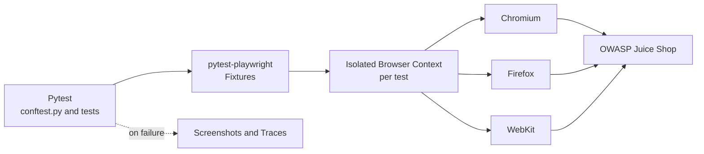
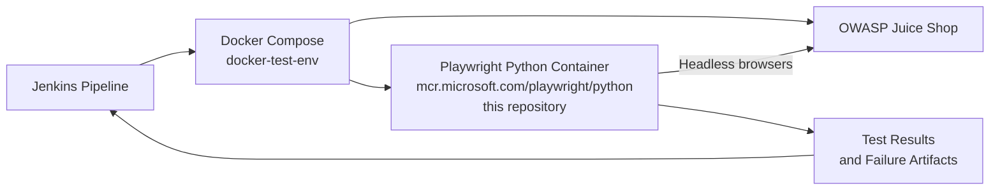

# 🎭 Cross-Browser E2E Automation Framework: Playwright, Python & Pytest


### End-to-End Web Testing with Playwright (Python bindings) and Pytest

This repository is an automated **end-to-end (E2E) testing suite** built with **Playwright for Python** and **pytest-playwright**. It runs user journeys against the **[OWASP Juice Shop](https://github.com/juice-shop/juice-shop)** application across **Chromium, Firefox and WebKit**, using isolated browser contexts and a headless Docker runner.

It is the **Playwright layer** of a larger CI/CD ecosystem: [docker-test-env](https://github.com/acorvello/docker-test-env) runs it with Juice Shop inside a **Jenkins pipeline**, alongside the [Cypress](https://github.com/acorvello/e2e-cypress-js), [Selenium](https://github.com/acorvello/e2e-selenium-java) and [API](https://github.com/acorvello/api-testing) suites.

---

## 🗺️ Quick Navigation

* [Engineering Highlights](#-engineering-highlights)
* [Architecture](#-architecture)
* [Where It Fits: CI/CD Pipeline](#-where-it-fits-cicd-pipeline)
* [Tech Stack](#%EF%B8%8F-tech-stack-and-dependencies)
* [Project Structure](#-project-structure)
* [Covered Scenarios](#-covered-scenarios)
* [Running Locally](#-running-locally)
* [Running via Docker](#-running-via-docker-cicd-orchestration)
* [Roadmap](#-roadmap-and-next-steps)

---

## 💡 Engineering Highlights

* **Cross-Browser Execution:** Runs the same tests on Chromium, Firefox and WebKit, reducing platform-specific surprises.
* **Isolated Browser Contexts:** Each test gets a fresh, independent browser context, so cookies, cache and session state do not leak between tests.
* **Failure Diagnostics:** Built on `pytest-playwright`, which supports screenshots and traces on failure to help root-cause analysis.
* **Environment-Driven Configuration:** The base URL is a parameter, so the same suite runs on a developer machine or inside containers.

---

## 🧭 Architecture



---

## 🧭 Where It Fits: CI/CD Pipeline



---

## 🛠️ Tech Stack and Dependencies

* **Automation Engine:** Playwright 1.48+ (Python bindings)
* **Test Runner:** pytest with pytest-playwright
* **Infrastructure:** Official Microsoft Playwright container image for headless runs in Jenkins CI/CD (via [docker-test-env](https://github.com/acorvello/docker-test-env))

---

## 📁 Project Structure

```text
e2e-playwright-python/
├── requirements.txt
├── pytest.ini
└── tests/
    ├── conftest.py
    └── test_juice_shop_login.py
```

---

## 🔍 Covered Scenarios

* **Home page:** loads successfully and lists the product components.
* **Navigation:** the login page renders when opened from the account menu.
* **Invalid login:** an error message is displayed when invalid credentials are submitted.

---

## 🚀 Running Locally

**Prerequisites:** Python 3.10+ and a running instance of Juice Shop (locally or in a container).

**Windows (PowerShell):**

```powershell
python -m venv .venv
.\.venv\Scripts\Activate.ps1
pip install -r requirements.txt
playwright install
pytest --base-url=http://localhost:3001 --browser chromium --browser firefox --browser webkit
```

**Linux / macOS:**

```bash
python -m venv .venv
source .venv/bin/activate
pip install -r requirements.txt
playwright install --with-deps
pytest --base-url=http://localhost:3001 --browser chromium --browser firefox --browser webkit
```

---

## 🐳 Running via Docker (CI/CD Orchestration)

This repository is consumed by the [docker-test-env](https://github.com/acorvello/docker-test-env) orchestration project. The pipeline starts Juice Shop and runs this suite inside the official `mcr.microsoft.com/playwright/python` container image, triggered and tracked by a unified Jenkins pipeline. See that project's `docker-compose.yml` for the full setup.

---

## 🔗 Related Projects

* [docker-test-env](https://github.com/acorvello/docker-test-env): Docker Compose + Jenkins + SonarQube orchestration
* [e2e-cypress-js](https://github.com/acorvello/e2e-cypress-js): Cypress E2E suite
* [e2e-selenium-java](https://github.com/acorvello/e2e-selenium-java): Selenium 4 + JUnit 5 suite
* [api-testing](https://github.com/acorvello/api-testing): REST API tests with Pytest
* [Profile & ecosystem overview](https://github.com/acorvello)

---

## 📈 Roadmap and Next Steps

* Integrate `pytest-html` to generate visual reports and archive them as CI artifacts
* Expand coverage to multi-step cart, basket and checkout flows
* Combine UI tests with API-level setup and checks (see [api-testing](https://github.com/acorvello/api-testing))

---

## ⚖️ License

This repository is licensed under the **MIT License**. Feel free to clone, study, modify, and distribute the code for educational or portfolio purposes.

---

## 👤 Author

**Alexsander Corvello da Silveira**, Senior QA Engineer focused on AI-driven testing and applied machine learning.
GitHub: [@acorvello](https://github.com/acorvello)
